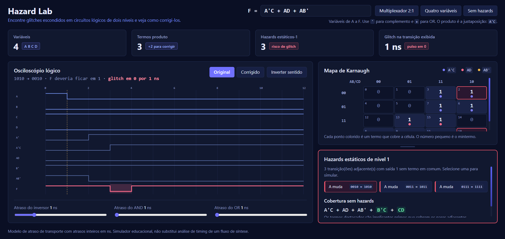

# hazard-lab


[](https://github.com/larissaribeiro-dev/hazard-lab/actions/workflows/ci.yml)


Analisador de hazards estáticos de nível 1 em circuitos AND-OR de dois níveis, com mapa de Karnaugh, correção automática por termos de consenso e simulação do glitch no tempo.

A ideia é mostrar uma coisa que a tabela-verdade esconde: uma função pode estar logicamente correta e, mesmo assim, a saída cair para 0 por alguns nanossegundos quando uma única entrada muda, porque os caminhos do circuito têm atrasos diferentes.

**Demo online:** [hazard-lab.web.app](https://hazard-lab.web.app)



```
F = A'C + AD + AB'

hazards:  0010 <-> 1010
          0011 <-> 1011
          0111 <-> 1111

cobertura sem hazards:  A'C + AD + AB' + B'C + CD
```

## Recursos

- Entrada em soma de produtos com até 6 variáveis (`A` a `F`), com validação e mensagens de erro
  - Complemento com `A'` ou `!A`, produto por justaposição, `*` ou `.`, e letras minúsculas são aceitas
- Detecção de todos os hazards estáticos de nível 1 para mudança de uma variável por vez
- Mapa de Karnaugh de qualquer tamanho, com a cobertura de cada termo marcada por cor
- Correção automática: cada par descoberto recebe um implicante primo (termo de consenso)
- Simulador em nível de portas com atraso configurável para inversor, AND e OR
- Formas de onda de todos os nós do circuito, com o glitch destacado
- Comparação entre o circuito original e o corrigido na mesma transição
- Painéis redimensionáveis: arraste a linha entre o Mapa de Karnaugh e os hazards (cada painel cresce até o limite do próprio conteúdo; duplo clique restaura, e as setas, Home, End e Esc funcionam com a linha focada)
- Testes automatizados do analisador e do simulador, sem dependências externas

## Como funciona

Cada termo produto é guardado como uma máscara de bits (quais variáveis aparecem) e um valor (qual polaridade cada uma tem). Isso permite checar se um termo cobre um mintermo com uma única operação, `(m & mask) === value`.

Um hazard estático-1 existe entre dois mintermos adjacentes `m` e `m'` (que diferem em um bit) quando a função vale 1 nos dois e nenhum termo cobre ambos. No mapa de Karnaugh, são duas células vizinhas com 1 que estão em grupos diferentes.

Para corrigir, o programa pega o cubo formado pelo par, remove o literal da variável que muda e tenta remover os demais literais enquanto o cubo continuar inteiro dentro do conjunto de uns da função. O resultado é um implicante primo, que mantém a saída em 1 durante a transição.

```
entradas -> [NOT] -> [AND por termo] -> [OR] -> F
              d_not       d_and         d_or
```

### Módulos

| Módulo | Arquivo | Função |
|--------|---------|--------|
| Parser e utilitários | `src/logic.js` | Lê a expressão, avalia mintermos e formata termos |
| Análise de hazards | `src/hazards.js` | Detecta hazards estáticos-1 e gera os termos de consenso |
| Simulador de temporização | `src/timing.js` | Calcula as formas de onda e detecta o glitch na saída |
| Divisor de painéis | `src/splitter.js` | Redimensionamento por arraste ou teclado, limitado ao conteúdo de cada painel |
| Interface | `src/app.js` | Mapa de Karnaugh, lista de hazards e osciloscópio em SVG |
| Página e estilos | `index.html`, `css/style.css` | Layout e tema |

## Decisões de projeto

**Por que atraso de transporte?** Cada porta apenas repete a função lógica de suas entradas deslocada no tempo. É o modelo mais simples que reproduz o glitch e é fácil de explicar. Um modelo inercial filtraria pulsos mais curtos que o atraso da porta, o que esconderia glitches estreitos.

**Por que a transição que causa o glitch depende do sentido?** Em `A'C + AD + AB'`, a mudança de `1011` para `0011` gera o glitch porque o termo `A'C` sobe depois que `AD` e `AB'` já caíram, pelo atraso do inversor. No sentido contrário o termo novo sobe antes e a saída não oscila. Por isso há o botão de inverter o sentido, e a interface já abre no sentido que produz o glitch, quando existe.

**Por que mostrar o hazard mesmo quando não há glitch?** O hazard é uma propriedade estrutural da cobertura: o glitch só aparece se os atrasos favorecerem a corrida. A ferramenta separa as duas coisas, e a primeira é independente dos atrasos escolhidos.

**Por que só estático-1?** Em circuitos de dois níveis na forma soma de produtos, uma mudança em uma variável não causa hazard estático-0. Hazards dinâmicos e múltiplas entradas mudando ao mesmo tempo ficaram fora do escopo.

## Como rodar

O projeto não tem dependências. A interface usa módulos ES, então precisa ser servida por HTTP (abrir o `index.html` direto pelo arquivo não funciona).

```bash
git clone https://github.com/larissaribeiro-dev/hazard-lab.git
cd hazard-lab
python -m http.server 8080
```

Abra `http://localhost:8080`. Se a página for aberta direto do disco, ela exibe um aviso no topo explicando o motivo. No Windows, se `python` não for reconhecido, use `py -m http.server 8080`.

## Publicar no Firebase Hosting

O projeto é estático, então não precisa de build. O `firebase.json` já aponta a raiz como pasta pública e deixa de fora `.git`, testes, `docs/`, `package.json`, README e LICENSE.

```bash
npm install -g firebase-tools
firebase login
firebase use --add        # escolha o projeto e dê o alias "default"
firebase deploy --only hosting
```

O site fica em `https://SEU-PROJECT-ID.web.app`.

## Testes

Requer Node.js 20 ou superior.

```bash
npm test
```

| Arquivo | O que cobre |
|---------|-------------|
| `tests/logic.test.js` | Parser, erros de entrada, avaliação, detecção de hazards e correção |
| `tests/timing.test.js` | Glitch com atrasos iguais, ausência de glitch após a correção, efeito do atraso do inversor, estabilidade da saída e detecção de pulsos |

A correção é validada de duas formas: a função corrigida é idêntica à original em todos os mintermos, e o simulador confirma que o glitch some na mesma transição.

## Estrutura do projeto

```
hazard-lab/
├── src/
│   ├── logic.js
│   ├── hazards.js
│   ├── timing.js
│   ├── splitter.js
│   └── app.js
├── tests/
│   ├── logic.test.js
│   └── timing.test.js
├── css/
│   └── style.css
├── .github/workflows/ci.yml
├── index.html
├── package.json
├── LICENSE
└── README.md
```

## Limitações

- Atrasos inteiros em ns e iguais para todas as portas do mesmo tipo
- Apenas circuitos AND-OR de dois níveis, com entradas e complementos disponíveis via inversores
- O mapa de Karnaugh para 5 e 6 variáveis usa a mesma ordenação em código Gray, e a adjacência também vale entre células espelhadas

## Roadmap

- [ ] Hazards estáticos-0 para circuitos em produto de somas
- [ ] Hazards dinâmicos e mudança simultânea de várias entradas
- [ ] Atraso individual por porta
- [ ] Exportar a cobertura corrigida em Verilog
- [ ] Validar as formas de onda contra uma simulação com Icarus Verilog
- [ ] Testes automatizados da interface (renderização e divisor de painéis)

## Referências

1. TOCCI, Ronald J.; WIDMER, Neal S.; MOSS, Gregory L. *Sistemas Digitais, Princípios e Aplicações*. 11. ed. São Paulo, Pearson Prentice Hall, 2011.
2. WAKERLY, John F. *Digital Design: Principles and Practices*. 4. ed. Upper Saddle River, Pearson Prentice Hall, 2006.

## Licença

Distribuído sob a licença MIT. Veja o arquivo [LICENSE](LICENSE).

Copyright (c) 2026 Larissa Rafaela Ribeiro de Souza ([@larissaribeiro-dev](https://github.com/larissaribeiro-dev))
